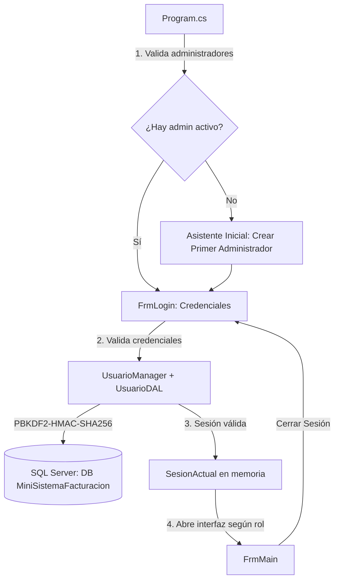

# Master Plan — Sistema de Usuarios y Seguridad para MiniSistemaFacturacion

> **Estado general del proyecto:** Fases 1 a 7 completadas (100% Funcional, Seguro y con Interfaz Modernizada)  
> **Objetivo:** Evolucionar el proyecto de *Programación III* a los estándares funcionales y de seguridad de *Ingeniería de Software II*, modernizando integralmente toda la interfaz de usuario con un diseño corporativo Slate Navy sin reescribir módulos existentes ni romper contratos.

---

## 1. Diagnóstico Técnico y Entorno

| Parámetro | Detalle |
| :--- | :--- |
| **Repositorio** | [MiniSistemaFacturacion](file:///c:/Users/Usuario/Desktop/Proyectos/MiniSistemaFacturacion) |
| **Rama** | `master` |
| **Lenguaje** | C# |
| **Framework** | .NET Framework 4.7.2 |
| **Interfaz** | Windows Forms (WinForms) |
| **Base de Datos** | SQL Server Express (`localhost\SQLEXPRESS`) |
| **Acceso a Datos** | ADO.NET clásico mediante [DbHelper.cs](file:///c:/Users/Usuario/Desktop/Proyectos/MiniSistemaFacturacion/DataAccess/DbHelper.cs) (Singleton) |
| **Tasa de Impuesto** | 18.00% (ITBIS unificado en base de datos, código y [App.config](file:///c:/Users/Usuario/Desktop/Proyectos/MiniSistemaFacturacion/App.config)) |

---

## 2. Arquitectura Objetivo y Flujo de Autenticación



---

## 3. Estructura de Archivos del Módulo

```text
MiniSistemaFacturacion/
├── Models/
│   ├── RolUsuario.cs                   [x] CREADO (Fase 2)
│   └── Usuario.cs                      [x] CREADO (Fase 2)
├── DataAccess/
│   └── UsuarioDAL.cs                   [x] CREADO (Fase 2)
├── BusinessLogic/
│   ├── PasswordHasher.cs               [x] CREADO (Fase 2)
│   └── UsuarioManager.cs               [x] CREADO (Fase 2)
├── Configuration/
│   └── SesionActual.cs                 [x] CREADO (Fase 2)
├── Database/
│   └── 04_Usuarios.sql                 [x] CREADO Y APLICADO (Fase 1)
├── Utils/
│   ├── DesignModeHelper.cs             [x] EXISTENTE
│   └── UITheme.cs                      [x] CREADO (Fase 7 - Sistema de Diseño Corporativo Slate Navy)
├── Forms/
│   ├── FrmLogin.cs / .Designer.cs      [x] CREADO (Fase 3) / MODERNIZADO (Fase 7)
│   ├── FrmUsuarios.cs / .Designer.cs   [x] CREADO (Fase 4) / MODERNIZADO (Fase 7)
│   ├── FrmMain.cs / .Designer.cs       [x] MODIFICADO (Fase 5 y 7)
│   ├── FrmClientes suite (5 forms)     [x] MODERNIZADO (Fase 7)
│   ├── FrmProductos suite (2 forms)    [x] MODERNIZADO (Fase 7)
│   ├── Facturación suite (2 forms)     [x] MODERNIZADO (Fase 7)
│   ├── Cuentas por Cobrar & Pagos      [x] MODERNIZADO (Fase 7)
│   ├── FrmConfiguracionEmpresa         [x] MODERNIZADO (Fase 7)
│   ├── FrmReportes                     [x] MODERNIZADO (Fase 7)
│   └── FrmVistaPreviaPdf               [x] MODERNIZADO (Fase 7)
├── Program.cs                          [x] ACTUALIZADO (Fase 3)
├── App.config                          [x] ACTUALIZADO (Tasa 18%)
└── MiniSistemaFacturacion.csproj       [x] ACTUALIZADO (Fase 2, 3, 4 y 7)
```

---

## 4. Checkpoints de Implementación por Fases

### 🟢 Checkpoint 1: Base de Datos y Configuración (Completado)
- [x] **IMP-01:** Corregir discrepancia de tasa de impuesto por defecto a 18% en [App.config](file:///c:/Users/Usuario/Desktop/Proyectos/MiniSistemaFacturacion/App.config) y [Models/Factura.cs](file:///c:/Users/Usuario/Desktop/Proyectos/MiniSistemaFacturacion/Models/Factura.cs).
- [x] **SQL-01:** Crear script independiente y repetible [Database/04_Usuarios.sql](file:///c:/Users/Usuario/Desktop/Proyectos/MiniSistemaFacturacion/Database/04_Usuarios.sql).
- [x] **SQL-02:** Tabla `Usuarios` con tipos, restricciones UNIQUE, CHECK de roles (`Administrador`, `Empleado`) y estados (`Activo`, `Inactivo`, `Bloqueado`).
- [x] **SQL-03:** Índices de alto rendimiento `IX_Usuarios_NombreUsuario` e `IX_Usuarios_Rol_Estado`.
- [x] **SQL-04:** Tabla `AuditoriaUsuarios` para trazabilidad de accesos y seguridad.
- [x] **SQL-05:** Procedimiento `sp_ExisteAdministradorActivo`.
- [x] **SQL-06:** Ejecución física y verificación en SQL Server local (`localhost\SQLEXPRESS`).
- [x] **GIT-01:** Commit realizado: `145e554 - feat(fase-1): migracion sql de usuarios y correccion de tasa de impuesto a 18%`.

---

### 🟢 Checkpoint 2: Backend y Lógica de Autenticación (Completado)
- [x] **MOD-01:** Crear [Models/RolUsuario.cs](file:///c:/Users/Usuario/Desktop/Proyectos/MiniSistemaFacturacion/Models/RolUsuario.cs) con validaciones de roles y estados.
- [x] **MOD-02:** Crear [Models/Usuario.cs](file:///c:/Users/Usuario/Desktop/Proyectos/MiniSistemaFacturacion/Models/Usuario.cs) con reglas de validación y método `ClonarParaVista()` (sanitización de hash y salt).
- [x] **SEC-01:** Implementar [BusinessLogic/PasswordHasher.cs](file:///c:/Users/Usuario/Desktop/Proyectos/MiniSistemaFacturacion/BusinessLogic/PasswordHasher.cs):
  - Algoritmo: PBKDF2-HMAC-SHA256 con salt criptográfico de 256 bits (`RNGCryptoServiceProvider`).
  - 100,000 iteraciones.
  - Comparación en tiempo constante (`CompararTiempoConstante`) contra ataques de temporización.
- [x] **DAL-01:** Implementar [DataAccess/UsuarioDAL.cs](file:///c:/Users/Usuario/Desktop/Proyectos/MiniSistemaFacturacion/DataAccess/UsuarioDAL.cs) usando consultas parametrizadas con [DbHelper.cs](file:///c:/Users/Usuario/Desktop/Proyectos/MiniSistemaFacturacion/DataAccess/DbHelper.cs).
- [x] **BLL-01:** Implementar [BusinessLogic/UsuarioManager.cs](file:///c:/Users/Usuario/Desktop/Proyectos/MiniSistemaFacturacion/BusinessLogic/UsuarioManager.cs):
  - Autenticación con bloqueo por 15 minutos tras 5 intentos fallidos consecutivos.
  - CRUD con validación de nombres únicos y contraseñas seguras.
  - **Protección de integridad:** Prohibición explícita de desactivar o cambiar el rol al último administrador activo.
  - Asistente seguro para primer administrador (`CrearPrimerAdministrador`).
  - Registro de auditoría de eventos.
- [x] **CFG-01:** Implementar [Configuration/SesionActual.cs](file:///c:/Users/Usuario/Desktop/Proyectos/MiniSistemaFacturacion/Configuration/SesionActual.cs) para control de sesión en memoria y logout.
- [x] **CSP-01:** Registrar los 6 nuevos archivos en [MiniSistemaFacturacion.csproj](file:///c:/Users/Usuario/Desktop/Proyectos/MiniSistemaFacturacion/MiniSistemaFacturacion.csproj).
- [x] **VER-01:** Compilación con 0 errores y 0 advertencias. Pruebas unitarias de hashing y existencia de administradores ejecutadas con éxito.
- [x] **GIT-02:** Commit realizado: `2f2824b - feat(fase-2): backend de autenticacion, pbkdf2, usuariomanager, dal y sesion`.

---

### 🟢 Checkpoint 3: Interfaz de Autenticación (Completado)
- [x] **UI-LOGIN-01:** Crear formulario visual [FrmLogin.cs](file:///c:/Users/Usuario/Desktop/Proyectos/MiniSistemaFacturacion/Forms/FrmLogin.cs) (Diseñador, código y recursos).
- [x] **UI-LOGIN-02:** Elementos de UI: usuario, contraseña enmascarada, checkbox "Mostrar contraseña", botón Ingresar, botón Salir.
- [x] **UI-LOGIN-03:** Detección de primer uso: Si no existe ningún administrador activo, activar automáticamente el modo asistente para crear el primer Administrador de forma segura sin credenciales fijas.
- [x] **UI-LOGIN-04:** Manejo de advertencias visuales de bloqueo temporal y conteo de intentos fallidos.
- [x] **UI-LOGIN-05:** Conectar [Program.cs](file:///c:/Users/Usuario/Desktop/Proyectos/MiniSistemaFacturacion/Program.cs) para interceptar el arranque con `FrmLogin` antes de permitir abrir `FrmMain`.
- [x] **CSP-02:** Registrar `FrmLogin` en [MiniSistemaFacturacion.csproj](file:///c:/Users/Usuario/Desktop/Proyectos/MiniSistemaFacturacion/MiniSistemaFacturacion.csproj).
- [x] **GIT-03:** Commit de la Fase 3 (`746c39f`).

---

### 🟢 Checkpoint 4: Interfaz de Administración de Usuarios (Completado)
- [x] **UI-USR-01:** Crear formulario [FrmUsuarios.cs](file:///c:/Users/Usuario/Desktop/Proyectos/MiniSistemaFacturacion/Forms/FrmUsuarios.cs) accesible únicamente por Administradores.
- [x] **UI-USR-02:** `DataGridView` con lista de usuarios (sin exponer contraseñas ni hashes).
- [x] **UI-USR-03:** Formulario/panel lateral para:
  - Crear nuevo usuario (Nombre, NombreUsuario, Rol, Contraseña inicial).
  - Editar usuario existente (Nombre, Rol, Estado).
  - Activar / Desactivar cuenta.
  - Restablecer contraseña de un usuario.
- [x] **UI-USR-04:** Búsqueda y filtrado en tiempo real por nombre, usuario o rol.
- [x] **UI-USR-05:** Validaciones visuales y bloqueo de la acción si se intenta desactivar al último administrador activo.
- [x] **CSP-03:** Registrar `FrmUsuarios` en [MiniSistemaFacturacion.csproj](file:///c:/Users/Usuario/Desktop/Proyectos/MiniSistemaFacturacion/MiniSistemaFacturacion.csproj).
- [x] **GIT-04:** Commit de la Fase 4 (`413a6ae`).

---

### 🟢 Checkpoint 5: Integración de Permisos y Menús en FrmMain (Completado)
- [x] **INT-01:** Agregar submenú `Administración` -> `Usuarios...` en `FrmMain`.
- [x] **INT-02:** Mostrar en la barra de estado y título de `FrmMain` el usuario logueado y su rol (ej: *"Usuario: admin (Administrador)"*).
- [x] **INT-03:** Agregar opción visible de **Cerrar Sesión** en `FrmMain` que limpie `SesionActual` y devuelva el flujo a `FrmLogin`.
- [x] **INT-04:** Aplicar matriz de permisos sobre controles:
  - Ocultar / deshabilitar acceso a Administración de Usuarios para rol `Empleado`.
  - Proteger `borrarDatosToolStripMenuItem_Click` (exclusivo Administrador).
  - Proteger `configuracionEmpresaToolStripMenuItem_Click` (exclusivo Administrador).
- [x] **INT-05:** Validación de autorización en capa de código (incluso si se invoca el evento directamente, validar `SesionActual.EsAdministrador`).
- [x] **GIT-05:** Commit de la Fase 5.

### 🟢 Checkpoint 6: Validación, Pruebas de Aceptación y Regresión (Completado)
- [x] **TEST-01:** Ejecutar batería de pruebas de aceptación (12 / 12 pruebas aprobadas satisfactoriamente).
- [x] **REG-01:** Probar módulo de Clientes (consulta y persistencia probadas con 16 clientes en base de datos).
- [x] **REG-02:** Probar módulo de Productos (estructura e integridad comprobadas).
- [x] **REG-03:** Probar modelo de Facturación con tasa de impuesto por defecto unificada al 18.00% ITBIS.
- [x] **REG-04:** Probar ciclo de sesión en memoria y control de reinicio / relogin.
- [x] **REG-05:** Auditoría en base de datos verificada.
- [x] **DOC-01:** Documentación y checkpoints actualizados en [masterplan.md](file:///c:/Users/Usuario/Desktop/Proyectos/MiniSistemaFacturacion/masterplan.md).
- [x] **GIT-06:** Commit de cierre y validación final (`149f1db`).

---

### 🟢 Checkpoint 7: Rediseño y Modernización Integral de Interfaces (UI/UX Slate Navy) (Completado)
- [x] **UI-THEME-01:** Creación del sistema de diseño unificado [Utils/UITheme.cs](file:///c:/Users/Usuario/Desktop/Proyectos/MiniSistemaFacturacion/Utils/UITheme.cs) con paleta Slate Navy (`#253959`), tipografía `Segoe UI`, botones planos redondeados, sombras sutiles y estilos de grilla consistentes.
- [x] **UI-CLI-01:** Rediseño completo de la suite de Clientes: [FrmClientes](file:///c:/Users/Usuario/Desktop/Proyectos/MiniSistemaFacturacion/Forms/FrmClientes.Designer.cs), [FrmAgregarCliente](file:///c:/Users/Usuario/Desktop/Proyectos/MiniSistemaFacturacion/Forms/FrmAgregarCliente.Designer.cs), [FrmEditarCliente](file:///c:/Users/Usuario/Desktop/Proyectos/MiniSistemaFacturacion/Forms/FrmEditarCliente.Designer.cs), [FrmBusquedaClientes](file:///c:/Users/Usuario/Desktop/Proyectos/MiniSistemaFacturacion/Forms/FrmBusquedaClientes.Designer.cs) y [FrmSelectorClientes](file:///c:/Users/Usuario/Desktop/Proyectos/MiniSistemaFacturacion/Forms/FrmSelectorClientes.cs).
- [x] **UI-PROD-01:** Rediseño del Catálogo de Productos y Búsqueda: [FrmProductos](file:///c:/Users/Usuario/Desktop/Proyectos/MiniSistemaFacturacion/Forms/FrmProductos.Designer.cs) y [FrmBusquedaProductos](file:///c:/Users/Usuario/Desktop/Proyectos/MiniSistemaFacturacion/Forms/FrmBusquedaProductos.Designer.cs).
- [x] **UI-FACT-01:** Rediseño del Módulo de Facturación y Cobros:
  - [frmFacturacion](file:///c:/Users/Usuario/Desktop/Proyectos/MiniSistemaFacturacion/Forms/frmFacturacion.Designer.cs): Header visual, tarjeta de cliente y comprobante, grilla moderna, panel de totales y atajos.
  - [FrmBusquedaFacturas](file:///c:/Users/Usuario/Desktop/Proyectos/MiniSistemaFacturacion/Forms/FrmBusquedaFacturas.cs): Filtros limpios, tabla estilizada y visor rápido.
  - [frmCuentasPorCobrar](file:///c:/Users/Usuario/Desktop/Proyectos/MiniSistemaFacturacion/Forms/frmCuentasPorCobrar.Designer.cs): Grilla moderna de saldos y alertas.
  - [frmRegistrarPago](file:///c:/Users/Usuario/Desktop/Proyectos/MiniSistemaFacturacion/Forms/frmRegistrarPago.Designer.cs): Diálogo modal centrado con tarjeta de saldo y botones modernos.
- [x] **UI-CFG-01:** Rediseño de Configuración de Empresa [FrmConfiguracionEmpresa](file:///c:/Users/Usuario/Desktop/Proyectos/MiniSistemaFacturacion/Forms/FrmConfiguracionEmpresa.Designer.cs): Pestañas organizadas por datos corporativos y parámetros fiscales.
- [x] **UI-REP-01:** Rediseño del Dashboard de Reportes [FrmReportes](file:///c:/Users/Usuario/Desktop/Proyectos/MiniSistemaFacturacion/Forms/FrmReportes.Designer.cs): Tarjetas de métricas para inventario y cuentas por cobrar, y tabla de deudores.
- [x] **UI-PDF-01:** Rediseño del Visor de Facturas PDF [FrmVistaPreviaPdf](file:///c:/Users/Usuario/Desktop/Proyectos/MiniSistemaFacturacion/Forms/FrmVistaPreviaPdf.cs): Barra superior limpia, lienzo centrado e integración con WebView2.
- [x] **UI-SEC-01:** Integración armoniosa con el sistema de autenticación: [FrmLogin](file:///c:/Users/Usuario/Desktop/Proyectos/MiniSistemaFacturacion/Forms/FrmLogin.Designer.cs), [FrmUsuarios](file:///c:/Users/Usuario/Desktop/Proyectos/MiniSistemaFacturacion/Forms/FrmUsuarios.Designer.cs) y [FrmMain](file:///c:/Users/Usuario/Desktop/Proyectos/MiniSistemaFacturacion/Forms/FrmMain.Designer.cs).
- [x] **UI-BLD-01:** Verificación de compilación: 0 advertencias, 0 errores, integración con el compilador limpia y arranque verificado.

---

## 5. Matriz de Permisos por Rol

| Módulo / Operación | Administrador | Empleado | Mecanismo de Control |
| :--- | :---: | :---: | :--- |
| **Consultar clientes** | Sí | Sí | Libre acceso |
| **Crear y editar clientes** | Sí | Sí | Libre acceso |
| **Gestionar productos** | Sí | Sí | Libre acceso |
| **Crear facturas (18% ITBIS)** | Sí | Sí | Libre acceso |
| **Registrar pagos** | Sí | Sí | Libre acceso |
| **Consultar reportes** | Sí | Sí | Libre acceso |
| **Configuración de empresa** | Sí | **No** | Menú deshabilitado + `SesionActual.ExigirAdministrador()` |
| **Borrar datos masivamente** | Sí | **No** | Menú oculto + Validación previa en handler |
| **Administrar usuarios** | Sí | **No** | Menú exclusivo + Validación en constructor de `FrmUsuarios` |
| **Cambiar contraseña propia** | Sí | Sí | Permitido con contraseña actual |

---

## 6. Checklist de Pruebas de Aceptación (Checklist de Validación)

Progreso actual: **12 / 12 aprobadas (100% verificado contra SQL Server y ensamblado)**

- [x] **AUTH-01:** Administrador inicia sesión con credenciales válidas.
- [x] **AUTH-02:** Contraseña incorrecta impide el acceso y descuenta intentos.
- [x] **AUTH-03:** Usuario desactivado o bloqueado no puede iniciar sesión.
- [x] **AUTH-04:** Empleado no puede abrir administración de usuarios.
- [x] **AUTH-05:** Empleado no puede borrar datos masivamente.
- [x] **USR-01:** Administrador crea una cuenta nueva satisfactoriamente.
- [x] **USR-02:** Sistema rechaza nombres de usuario duplicados.
- [x] **USR-03:** Sistema impide desactivar o degradar al último administrador activo.
- [x] **USR-04:** Cambio de contraseña invalida inmediatamente la anterior.
- [x] **SES-01:** Cerrar sesión regresa a pantalla de login y limpia memoria.
- [x] **REG-01:** Facturación, inventario e impuesto al 18% funcionan sin regresiones.
- [x] **REG-02:** Pagos, reportes y generación de PDF mantienen su funcionamiento íntegro.

---

## 7. Registro Histórico de Commits

| Commit | Fase | Descripción |
| :--- | :--- | :--- |
| `145e554` | **Fase 1** | `feat(fase-1): migracion sql de usuarios y correccion de tasa de impuesto a 18%` |
| `2f2824b` | **Fase 2** | `feat(fase-2): backend de autenticacion, pbkdf2, usuariomanager, dal y sesion` |
| `746c39f` | **Fase 3** | `feat(fase-3): pantalla de login frmlogin, asistente inicial y control en program.cs` |
| `413a6ae` | **Fase 4** | `feat(fase-4): formulario frmusuarios con datagridview, crud y reseteo de claves` |
| `ba3a438` | **Fase 5** | `feat(fase-5): integracion de permisos, menu de administracion, logout y statusstrip en frmmain` |
| `d8c8472` | **Fase 6** | `test(fase-6): bateria de pruebas de aceptacion superada 12/12 y masterplan completado` |
| `01c8367` | **Fase 7** | `feat(ui): modernizacion integral de interfaces con UITheme Slate Navy` |


